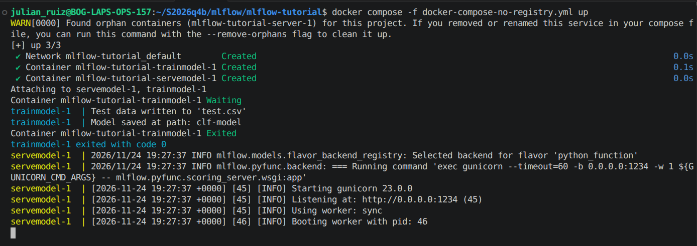
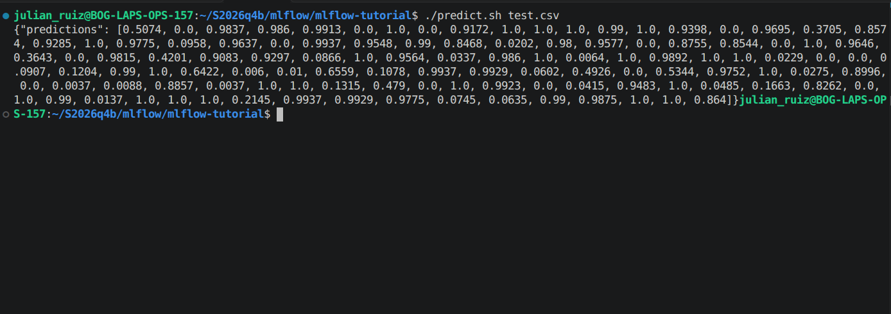
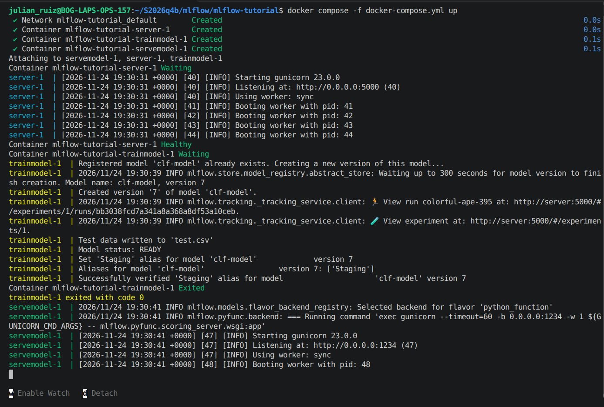
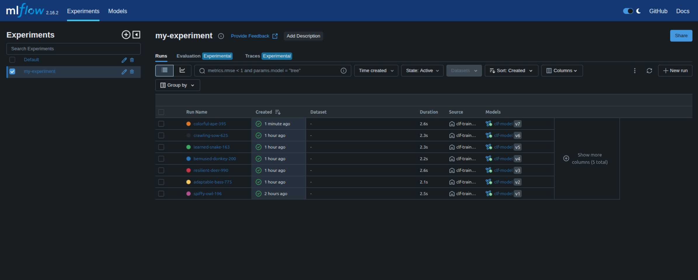
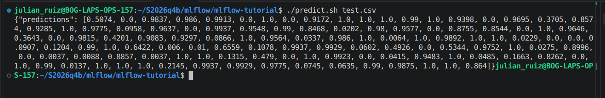
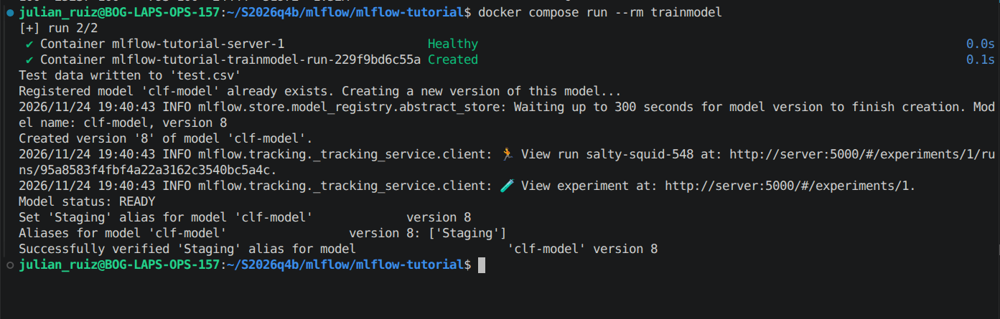
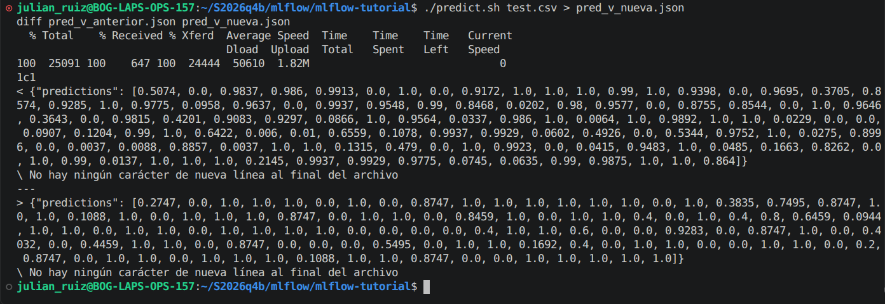
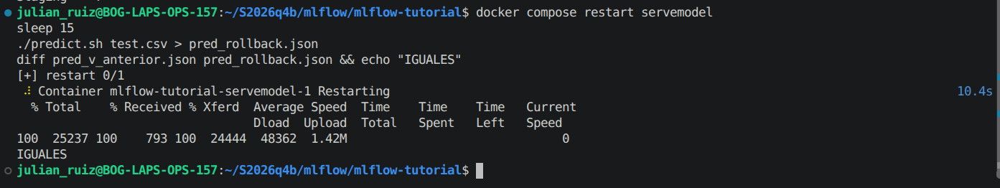
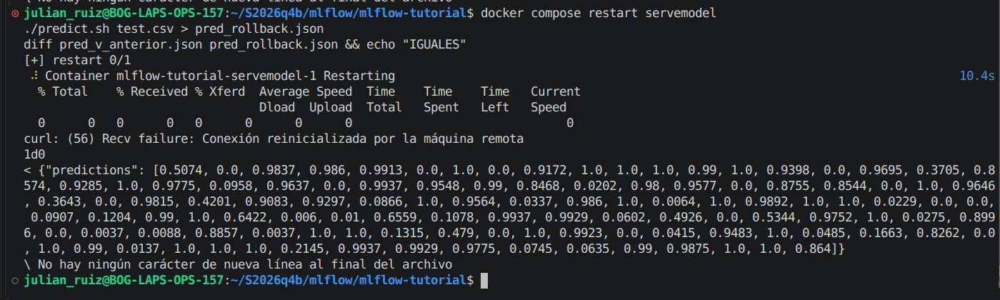

# Taller Hands-On: MLflow + Docker – del dato al modelo desplegado

Semillero 2026Q4B · Julián Ruiz

Este taller repasa el **data lifecycle** (ingestión → transformación → consumo) aplicado al **ciclo de vida de un modelo de ML** (entrenamiento → validación → registro → despliegue → inferencia). Como vehículo se usa un clasificador Random Forest sobre el dataset *Breast Cancer* de scikit-learn. El foco no está en el dominio, sino en cómo un dato se convierte en un modelo versionado y desplegado.

- Tutorial base: [Machine Learning Model Serving for Newbies with MLflow](https://towardsdatascience.com/machine-learning-model-serving-for-newbies-with-mlflow-76f9f0ac3cb2/?sk=3fabd570be956c5830591f9ac0fa7991) (Maria Patterson)
- Código base: [mtpatter/mlflow-tutorial](https://github.com/mtpatter/mlflow-tutorial) (MLflow 2.16.2)
- Explicación detallada de cada comando: [`PASO-A-PASO-mlflow.md`](PASO-A-PASO-mlflow.md)

---

## 1. Requisitos

- Docker y Docker Compose
- Git
- `curl`

Según los lineamientos del taller, **MLflow, el entrenamiento, el tracking, el registro y el serving se ejecutan dentro de Docker**. En la máquina local solo se instalan dependencias para explorar los datos.

```bash
git clone https://github.com/mtpatter/mlflow-tutorial.git
cd mlflow-tutorial
```

### Ajuste necesario en `requirements.txt`

```diff
 mlflow==2.16.2
 numpy==2.1.1
 pandas==2.2.2
 scikit-learn==1.5.1
 scipy==1.14.1
 cloudpickle==3.0.0
+sqlalchemy<2.1
```

Sin esta línea, pip instala SQLAlchemy 2.1, que eliminó `FallbackAsyncAdaptedQueuePool`. Como MLflow 2.16.2 importa esa clase, el servidor no arranca (ver [Problemas encontrados](#6-problemas-encontrados)).

---

## 2. Arquitectura

| Servicio | Imagen | Comando | Puerto |
|---|---|---|---|
| `server` | `Dockerfile` | `mlflow server --backend-store-uri sqlite:///mlflow.db --default-artifact-root ./mlflow-artifact-root` | `8000 → 5000` (UI) |
| `trainmodel` | `Dockerfile` | `python clf-train.py` (sin registro) o `python clf-train-registry.py` (con registro) | — |
| `servemodel` | `Dockerfile` | `mlflow models serve -m <modelo> -p 1234` | `1234` (API) |

```
            ┌──────────────┐  registra run, métricas,   ┌──────────────┐
 dataset ──▶│  trainmodel  │──── versión y alias ──────▶│    server    │◀── UI localhost:8000
            └──────────────┘                            │ mlflow.db +  │
                                                        │ artifacts    │
                                                        └──────┬───────┘
                                       models:/clf-model@Staging│
                                                        ┌──────▼───────┐
 test.csv ──── POST /invocations (localhost:1234) ─────▶│  servemodel  │──▶ predicciones
                                                        └──────────────┘
```

**Qué hace el entrenamiento:** carga el dataset (569 filas y 30 features), lo divide 80/20 con `random_state=123` y `stratify`, entrena un pipeline `StandardScaler` + `RandomForestClassifier(n_estimators=100)`, escribe el 20 % de prueba en `test.csv` (sin la columna target) y sobrescribe `predict` para que devuelva la **probabilidad de la clase 1 (benigno)**.

---

## 3. Ruta A – Sin registro (modelo en disco)

```bash
rm -rf clf-model          # MLflow no sobrescribe una carpeta de modelo existente
docker compose -f docker-compose-no-registry.yml up --build
```

`trainmodel` entrena y guarda el modelo en `clf-model/`. Luego `servemodel` lo sirve en el puerto 1234.



Inferencia (en otra terminal):

```bash
./predict.sh test.csv
# = curl http://localhost:1234/invocations -H 'Content-Type: text/csv' --data-binary @test.csv
```



La respuesta es una lista de 114 probabilidades, una por fila de `test.csv`.

Para apagar:

```bash
docker compose -f docker-compose-no-registry.yml down --remove-orphans
```

**Limitación:** no hay historial, métricas, versiones ni UI. Para guardar un modelo nuevo hay que borrar el anterior.

---

## 4. Ruta B – Con registro (tracking + versiones + alias)

```bash
docker compose -f docker-compose.yml up
```

1. `server` arranca MLflow y pasa el healthcheck.
2. `trainmodel` ejecuta `clf-train-registry.py`: crea un run en `my-experiment`, registra `accuracy_train` y `accuracy_test`, registra el modelo como **nueva versión** de `clf-model` y le asigna el alias **`@Staging`**.
3. `servemodel` sirve `models:/clf-model@Staging`.



UI en **http://localhost:8000**. Cada ejecución del entrenamiento queda como un run con su versión de modelo (v1…v7):



Inferencia:

```bash
./predict.sh test.csv
```



> Las predicciones son **idénticas** a las de la ruta A y a las de todas las versiones v1–v7. Como el split y el Random Forest usan `random_state=123`, reentrenar con los mismos datos y parámetros produce el mismo modelo. Esto es **reproducibilidad**.

---

## 5. Versionamiento y rollback

### 5.1 Nueva versión con un hiperparámetro distinto

```bash
./predict.sh test.csv > pred_v_anterior.json      # predicciones de la v7
# editar clf-train-registry.py: n_estimators=100  →  n_estimators=5
docker compose run --rm trainmodel                # registra la v8 y le mueve @Staging
```



```bash
docker compose restart servemodel                 # recarga @Staging → v8
./predict.sh test.csv > pred_v_nueva.json
diff pred_v_anterior.json pred_v_nueva.json
```



Con solo 5 árboles, las probabilidades de la v8 son más "gruesas": muchos 0.0 y 1.0 exactos y valores como 0.4, 0.6 u 0.8747. Esto ocurre porque hay pocos árboles votando. El `servemodel` empezó a servir la nueva versión **sin cambiar su configuración**, solo porque se movió el alias.

### 5.2 Rollback a la v7

1. Mover el alias `Staging` a la v7. Un alias solo apunta a una versión, así que se quita automáticamente de la v8. Hay dos formas:
   - En la UI: **Models → clf-model → Version 7 → Aliases → agregar `Staging`**.
   - Por comando, dentro de Docker:
     ```bash
     docker compose run --rm trainmodel python -c "from mlflow import MlflowClient; c=MlflowClient('http://server:5000'); c.set_registered_model_alias('clf-model','Staging','7'); print('Staging ->', c.get_model_version_by_alias('clf-model','Staging').version)"
     ```
2. Reiniciar y esperar a que el servidor esté listo antes de predecir:

```bash
docker compose restart servemodel
sleep 15                                          # el servidor tarda ~10 s en arrancar
./predict.sh test.csv > pred_rollback.json
diff pred_v_anterior.json pred_rollback.json && echo "IGUALES"
```



El rollback devuelve la API a la v7 **sin reentrenar ni tocar código**.

### 5.3 Limpieza

```bash
# restaurar n_estimators=100 en clf-train-registry.py
docker compose down
```

`mlflow.db` y `mlflow-artifact-root/` se conservan en la carpeta, porque están montados como volumen.

---

## 6. Problemas encontrados

| Problema | Causa | Solución |
|---|---|---|
| `ImportError: cannot import name 'FallbackAsyncAdaptedQueuePool'` → `server` unhealthy y los demás contenedores no arrancan | SQLAlchemy no tenía versión fijada y pip instaló la 2.1, incompatible con MLflow 2.16.2 | `sqlalchemy<2.1` en `requirements.txt` + `docker compose up --build` |
| `405 Method Not Allowed` en `/invocations` | El `curl` quedó partido en dos líneas y se envió como un GET sin datos | Escribir el comando en una sola línea (o con `\`), o usar `./predict.sh test.csv` |
| `mlflow: orden no encontrada` / `python: orden no encontrada` | Se ejecutaron los scripts en el host, que no tiene MLflow (y en Ubuntu el comando es `python3`) | Ejecutarlos dentro de Docker: `docker compose run --rm trainmodel ...` |
| `localhost:8000` → `ERR_CONNECTION_REFUSED` | Estaba corriendo el compose **sin registro**, que no tiene el servicio `server` | `docker compose -f docker-compose.yml up` |
| `Error saving model at path clf-model: Path 'clf-model' already exists` (y el proceso termina con exit 0) | `save_model` no sobrescribe una carpeta existente y el script captura el error | `rm -rf clf-model` antes de entrenar (o `sudo rm -rf` si la creó root desde el contenedor) |
| `curl: (56) Recv failure: Conexión reinicializada` justo después de `restart servemodel` | Se hizo el predict mientras el servidor todavía estaba reiniciando, así que `pred_rollback.json` quedó vacío | Esperar el `Listening at: http://0.0.0.0:1234` (o `sleep 15`) antes de predecir |
| Después del rollback, el `diff` seguía mostrando las predicciones de la v8 | Se reinició `servemodel` sin haber movido antes el alias, así que `@Staging` seguía en la v8 | Mover `@Staging` a la v7 primero y después reiniciar `servemodel` |



---

## 7. Data lifecycle vs. ciclo de vida del modelo

| Data lifecycle | Ciclo del modelo | En este taller | ¿Se mantiene, cambia o se amplía? |
|---|---|---|---|
| Ingestión | Carga de datos de entrenamiento | `load_breast_cancer()` | **Se mantiene**: sigue siendo traer datos de una fuente |
| Transformación | Preparación + **entrenamiento** | split 80/20, `StandardScaler`, `fit()` | **Se amplía**: la transformación queda empaquetada *dentro* del modelo (pipeline) |
| Calidad de datos | **Validación** | `accuracy_train` / `accuracy_test` registradas en el run | **Cambia**: se valida el desempeño del modelo, no solo el dato |
| Linaje / versionado | **Tracking + registro** | runs en `my-experiment`, versiones v1…v8 de `clf-model` | **Se amplía**: se versionan juntos código, parámetros, métricas y artefacto |
| Publicación | **Despliegue** | `servemodel` + alias `@Staging` | **Cambia**: se publica una API, no una tabla. El alias permite promover y hacer rollback |
| Consumo | **Inferencia** | `predict.sh` → `POST /invocations` | **Cambia**: el consumidor envía datos nuevos y recibe predicciones |

**Conclusión:** los conceptos de trazabilidad, versionado y reproducibilidad del data lifecycle se mantienen. Lo que se amplía es *qué* se versiona: ya no solo datos, sino el modelo con sus parámetros y métricas. La reproducibilidad depende de fijar versiones de dependencias (`sqlalchemy<2.1`) y semillas (`random_state`). En AWS, este mismo flujo se escala con Amazon SageMaker (Model Registry, endpoints y pipelines).

---

## 8. Referencias

- [Machine Learning Model Serving for Newbies with MLflow](https://towardsdatascience.com/machine-learning-model-serving-for-newbies-with-mlflow-76f9f0ac3cb2/?sk=3fabd570be956c5830591f9ac0fa7991)
- [mtpatter/mlflow-tutorial](https://github.com/mtpatter/mlflow-tutorial)
- [MLflow tutorial – Kevin Njagi](https://medium.com/@kevinnjagi83/mlflow-tutorial-63a9ab1a220d)
- [AWS Prescriptive Guidance – Build an MLOps workflow](https://docs.aws.amazon.com/es_es/prescriptive-guidance/latest/patterns/)
